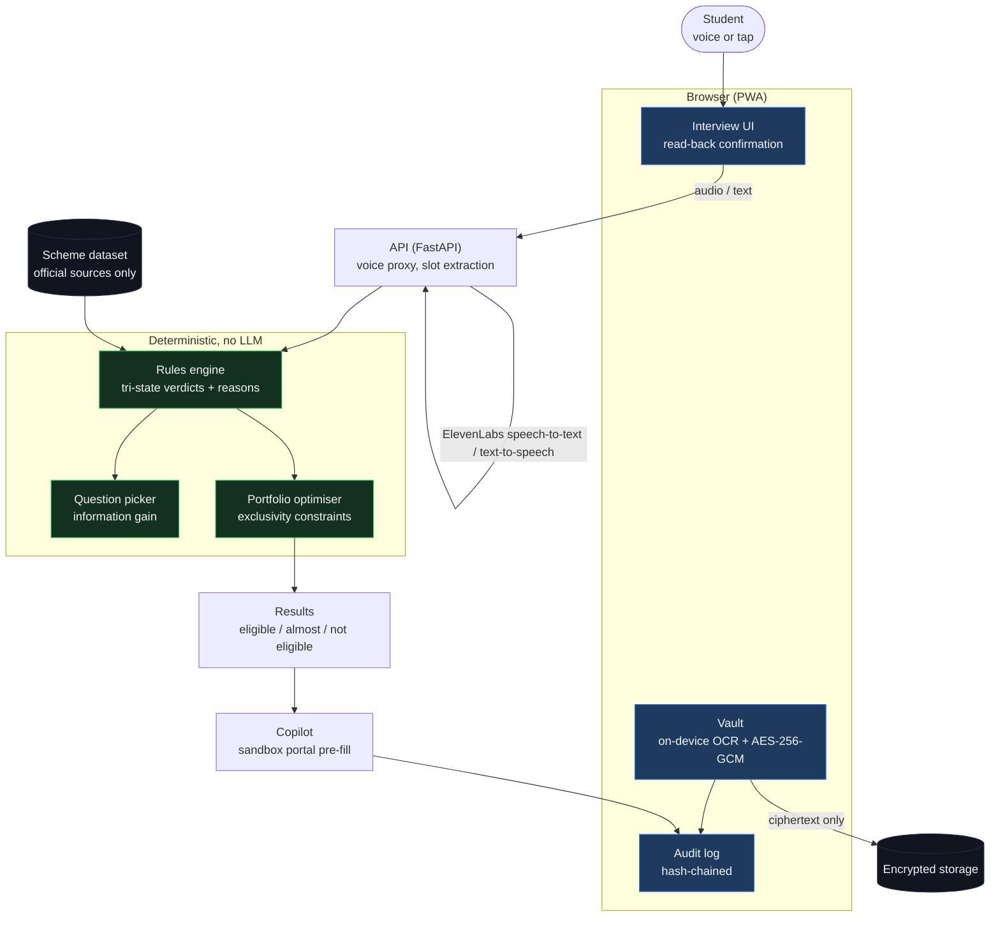

<div align="center">

# 🧭 Saarthi

**A voice-first, privacy-preserving scholarship navigator for Indian students.**

[](#team)
[]()
[]()

<p>


<br>


</p>

Saarthi tells a student which scholarships they actually qualify for, picks the best combination, keeps their documents in an encrypted vault on their own device, and helps fill the applications, in their own language.

*Eligibility is decided by a deterministic, explainable rules engine. The LLM only helps with conversation.*

</div>

<!--  -->

---

## The Problem

India has many central and state scholarships, but students from underserved backgrounds miss most of them:

- **They don't know the schemes exist.**
- **Eligibility is scattered** across notices and PDFs: income, category, course, domicile, marks.
- **Applications get rejected** for mismatched names, expired certificates and missing documents.
- **Portals are English-heavy** and hard to use on a phone.
- **Trust is a barrier.** Uploading income, caste and ID documents to yet another service is risky.

## What Saarthi Does

| Step | Description |
|---|---|
| **1. Ask** | A short voice or tap interview. The next question is chosen by information gain, so a student answers about 6-8 questions, not a 40-field form. Every answer is read back for confirmation. |
| **2. Match** | A deterministic rules engine checks each scheme and returns *eligible*, *ineligible* or *unknown*, with the reason for every verdict. It also shows near-misses ("you miss this by Rs 20,000" or "you'd qualify with a caste certificate"). |
| **3. Optimise** | Some schemes are mutually exclusive. Saarthi picks the best combination by expected value, deadline urgency and effort. |
| **4. Protect** | Documents are encrypted in the browser (AES-256-GCM) with a key from the student's passphrase. The server only ever sees ciphertext. Every access is written to a tamper-evident audit log. |
| **5. Apply** | A copilot pre-fills the application form and checks rejection risk. The student does OTP, CAPTCHA and final submit. |

> **Design principle:** the LLM converses and extracts. The rules engine decides. The LLM never reads documents and never determines eligibility.

---

## Previews

*Screenshots coming soon.*

<!--
| Voice Interview | Results |
|:---:|:---:|
|  |  |

<div align="center">
  <b>Encrypted Vault & Audit Log</b><br/><br/>
  
</div>
-->

---

## Architecture



- **Frontend:** Next.js, TypeScript, PWA, WebCrypto
- **Backend:** FastAPI, Pydantic, Python
- **Voice:** ElevenLabs speech-to-text and text-to-speech, called from the backend (keys stay server-side)
- **Data:** a structured scheme dataset built from official portals and guideline documents

Full technical detail in [`context/`](context/).

---

## What's Real vs. Planned

We're upfront about this, since it matters for judging the demo honestly. Update the status column as features land.

| Component | Status |
|---|:---:|
| Scheme dataset (central + Karnataka, undergraduate engineering) | 🟡 **In progress**, being collected from official sources |
| Eligibility engine (tri-state verdicts, explanations, near-miss) | 🟡 **Planned for round 1** |
| Adaptive interview (information-gain question picker) | 🟡 **Planned for round 1** |
| Encrypted vault (browser-side AES-256-GCM) and audit log | 🟡 **Planned for round 1** |
| Voice interview and spoken results (ElevenLabs) | 🟡 **Planned**, depends on language testing |
| Portfolio optimiser | 🟡 **Planned** |
| Application copilot | 🟠 **Sandbox demo only**, never real government portals |
| Cross-document consistency checker, helper mode, reminders | ⚪ **Roadmap** |

**Limits to keep in mind**
- Scheme criteria, amounts and deadlines go stale. Every record carries a `source_url` and `last_verified` date.
- Saarthi says a student *appears eligible*. It is not an approval, and the official notice is the final word.
- Kannada speech recognition quality on real, noisy audio is still being tested.
- Voice audio goes to a cloud service. Students are asked to speak profile answers only, never IDs or document contents.
- A lost passphrase means lost vault data, so a recovery key is offered.
- Saarthi is not legal advice, and we make no claim of compliance with India's Digital Personal Data Protection Act, 2023.

---

## Security Model

- **Client-side encryption:** each document gets a fresh AES-256-GCM key, wrapped by a key derived from the student's passphrase. The passphrase and plaintext never leave the browser.
- **On-device OCR:** raw documents are never uploaded for processing.
- **Consent per field and purpose:** grants are explicit and expire.
- **Hash-chained audit log:** each entry includes the hash of the previous one, so edits are detectable. It records field names and purposes, never values.
- **Copilot hardening:** form filling is deterministic field mapping. Page text is never treated as instructions, and only an allowlisted domain is used.
- **Never stored or logged:** government ID numbers, raw voice audio, OTPs, passphrases.

---

## Getting Started

```bash
# Backend
cd api
pip install -r requirements.txt
uvicorn main:app --reload

# Frontend
cd web
npm install
npm run dev

# Engine tests
cd engine
pytest
```

Copy `.env.example` to `.env` and add your own keys. **Never commit real keys, real documents or personal data.** The repo uses synthetic profiles only.

Open **http://localhost:3000**.

---

## Project Structure

```
web/       Next.js + TypeScript PWA (UI, voice, vault, copilot UI)
api/       FastAPI: schemes, eligibility, interview, optimiser, voice proxy
engine/    Pure-Python rules engine, question picker, optimiser
data/      Scheme dataset and synthetic test profiles
sandbox/   Replica portal for the copilot demo
docs/      Architecture, threat model, pitch material
context/   Project context, contracts and standards for team agents
```

See [`AGENTS.md`](AGENTS.md) and [`context/`](context/) for the full technical documentation this project is built against: project context, data contracts, code standards, team plan and decision log.

---

## Team

Built by:

| Name |
|---|
| Ibrahim |
| Rishon Thomas Joby |
| Samarth P Rao |
| Samarth Sainath Naik |

Built for **wHACKiest 2026**, organised by CodeRIT at Ramaiah Institute of Technology, Bengaluru. Track 4: UnlockED.

---

## Demo Video

*Link coming soon.*
